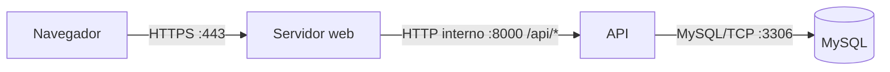

# Infraestrutura: proposta para produção

Este documento propõe um caminho para levar o projeto da máquina local à produção. Não descreve uma infraestrutura já publicada nem escolhe provedor ou ferramentas.

## 1. Arquitetura de produção

**Proposta:** o servidor web, a API e o MySQL rodam na mesma máquina de produção, com apenas o servidor web exposto à internet. O navegador acessa a tela e a API pela mesma origem. O servidor web encaminha `/api/*` à API interna na porta 8000, mapeando o caminho para as rotas atuais da API.

Para testar no mermaid.live, cole **só o conteúdo** do diagrama, começando em `flowchart LR`, sem incluir as linhas das crases.

- **Navegador:** roda na máquina do usuário; não atende em uma porta de servidor nem recebe conexões públicas de entrada.
- **Servidor web:** roda na máquina de produção; atende publicamente em HTTPS na porta 443 e recebe o tráfego público.
- **API:** roda na máquina de produção; atende internamente na porta 8000 e recebe tráfego encaminhado pelo servidor web, não diretamente da internet.
- **MySQL:** roda na máquina de produção; atende internamente na porta 3306 e recebe tráfego da API, não diretamente da internet.

## 2. Desenvolvimento e produção

| Item | Desenvolvimento — projeto atual | Produção — proposta |
|---|---|---|
| API | FastAPI iniciado com `fastapi dev main.py` na porta 8000. O front centraliza as chamadas em `frontend/src/api.js`; o endereço vem de `VITE_URL_DA_API` nos arquivos de ambiente do Vite. | API na porta interna 8000. O servidor web recebe `/api/*` em HTTPS 443 e encaminha as chamadas para ela. `VITE_URL_DA_API` usa o caminho relativo `/api`, na mesma origem da tela. |
| Tela | React servido pelo Vite em desenvolvimento na porta 5173. O projeto gera os arquivos de produção com `npm run build`, em `dist/`. | Arquivos gerados pelo build servidos pelo servidor web na mesma origem HTTPS da API. O Vite de desenvolvimento não é o servidor público. |
| Banco | MySQL na porta 3306. O exemplo de configuração usa `localhost`; o endereço efetivo em uso não foi verificado (?). | MySQL acessível internamente na porta 3306, somente pela API. Sem acesso público direto ao banco. |
| `.env` | `backend/configuracao.py` carrega a configuração do lado do servidor; existe um `backend/.env.exemplo`. Os valores efetivos do `.env` não foram verificados (?). | Configuração e segredos ficam apenas no ambiente do servidor, fora dos arquivos públicos da tela e do repositório. Os valores precisam corresponder aos endereços internos e ao domínio usado em produção; nenhum valor é definido aqui. |
| CORS | A API configura CORS com uma origem exata lida pela configuração do servidor, conforme `backend/main.py` e `backend/configuracao.py`. | Tela e API são acessadas pela mesma origem, com `/api` encaminhado pelo servidor web. Portanto, o navegador não precisa de CORS entre elas. |

## 3. O caminho do login

1. **Máquina do usuário — navegador:** a pessoa preenche e clica em “Entrar”. A tela coleta e-mail e senha e inicia o envio.
2. **Máquina do usuário → máquina de produção:** o navegador envia um `POST` com JSON para `/api/autenticacao/login`, por HTTPS na porta 443. O servidor web recebe a chamada pública e a encaminha à API interna na porta 8000.
3. **Máquina de produção — API e banco:** a API valida o formato dos dados, procura a conta pelo e-mail no MySQL pela porta interna 3306 e compara a senha informada com o hash guardado. Senha inválida resulta em resposta de erro de autenticação.
4. **Máquina de produção — API; depois máquina do usuário — navegador:** se as credenciais forem válidas, a API emite um token Bearer e o devolve pelo servidor web, como resposta HTTPS. A tela guarda o token na sessão da aba do navegador.
5. **Máquina do usuário → máquina de produção:** a tela faz `GET /api/usuarios/eu`, enviando o token Bearer. O servidor web encaminha essa chamada à API interna.
6. **Máquina de produção — API e banco:** a API valida o token e consulta a conta e suas permissões no banco. Devolve os dados públicos do perfil; não precisa devolver o hash da senha.
7. **Máquina do usuário — navegador:** a tela recebe o perfil e mostra as telas correspondentes ao papel retornado pela API. Esse fluxo de token e perfil está implementado em `frontend/src/App.jsx`, `backend/rotas/autenticacao.py` e `backend/rotas/usuarios.py`.

## 4. O que está chumbado

Os itens listados abaixo já foram resolvidos. O endereço da API agora mora nos arquivos de ambiente do Vite e é lido em um único ponto central em `frontend/src/api.js`.

| Arquivo | Situação |
|---|---|
| `frontend/src/api.js` | Resolvido: exporta `URL_DA_API` a partir de `import.meta.env.VITE_URL_DA_API` e continua montando as rotas com concatenação, como `URL_DA_API + "/rota"`. |
| `frontend/.env.development` | Resolvido: o endereço de desenvolvimento agora mora aqui como `VITE_URL_DA_API=http://localhost:8000`. |
| `frontend/.env.production` | Resolvido: o endereço de produção agora mora aqui como `VITE_URL_DA_API=/api`, mantendo a mesma origem da tela. |
| `backend/configuracao.py`, linha 31 | Não é um endereço do navegador; continua sendo o valor do servidor para CORS, não parte do front-end. |
| `backend/configuracao.py`, linha 58 | Não é um endereço do navegador; continua sendo o host interno do MySQL usado pela API. |
| `backend/alembic.ini`, linha 107 | Não é um endereço do navegador; continua sendo configuração de migração do banco, não da tela. |

### Exemplos de configuração

| Arquivo e linha | Uso |
|---|---|
| `frontend/.env.development`, linha 1 | Endereço de desenvolvimento usado pelo navegador para chamar a API local. |
| `frontend/.env.production`, linha 1 | Caminho relativo `/api` usado pelo navegador em produção, na mesma origem da tela. |
| `backend/.env.exemplo`, linha 4 | Exemplo de origem do front para a configuração de CORS; não confirma o valor efetivo do `.env` atual. |
| `backend/.env.exemplo`, linha 11 | Exemplo do host do banco; não confirma o destino efetivo da conexão atual. |

### Perguntas que um professor poderia fazer

1. Por que o navegador não deve se conectar diretamente ao MySQL?
2. Como o uso de `/api` na mesma origem muda a necessidade de CORS em relação ao desenvolvimento atual?
3. No fluxo de login, o que a API consulta no banco e o que ela devolve ao navegador?
