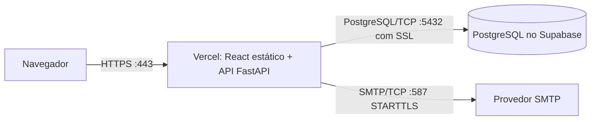

# Infraestrutura: como o projeto roda hoje

Este documento descreve a infraestrutura que o projeto usa hoje, não uma proposta. O sistema está
publicado na Vercel e usa um PostgreSQL do Supabase. O `docker-compose.yml` da raiz é legado: ele
ainda declara MySQL e não é o caminho de execução da API atual.

## 1. Arquitetura de produção

O navegador fala HTTPS com a Vercel. A Vercel entrega o React já compilado e executa a API FastAPI
como função serverless. A API fala com o PostgreSQL do Supabase pela porta 5432, com SSL. O envio de
email sai da API para um provedor SMTP com STARTTLS.

O projeto tem dois desenhos de deploy válidos:

- **Projeto único na Vercel:** `vercel.json` da raiz monta o front em `frontend/dist` e a API em
  `api/index.py`. É o desenho do repositório.
- **Dois projetos na Vercel:** um com Root Directory `frontend/` e outro com Root Directory
  `backend/`. O `frontend/vercel.json` encaminha `/api/*` para o domínio do projeto de API,
  removendo o prefixo. Nesse caso, `VITE_URL_DA_API` fica `/api`.

- **Navegador:** roda na máquina da pessoa; não atende em porta de servidor.
- **Vercel:** recebe o tráfego público em HTTPS na 443, entrega os arquivos do React e executa a API.
- **Supabase:** atende o PostgreSQL na 5432; só a API acessa, com SSL. O banco não é público.
- **SMTP:** recebe a conexão da API na 587, com STARTTLS, só para os emails de redefinição de senha.

## 2. Desenvolvimento e produção

| Item | Desenvolvimento | Produção |
|---|---|---|
| API | FastAPI com `fastapi dev main.py` na porta 8000. O endereço vem de `VITE_URL_DA_API` e é lido em `frontend/src/api.js`. | Função serverless da Vercel, entrada em `api/index.py` ou `backend/api/index.py`. O front chama `/api/*` ou a URL do projeto de API. |
| Tela | React com Vite na porta 5173. `npm run build` gera `dist/`. | Arquivos estáticos gerados pelo build, servidos pela Vercel. O Vite não é o servidor público. |
| Banco | PostgreSQL do Supabase, ou um PostgreSQL local pelas variáveis `BANCO_*`. | PostgreSQL do Supabase, acessado pela API com `SUPABASE_DB_URL`, `SUPABASE_DB_PASSWORD` e `BANCO_SSLMODE=require`. |
| `.env` | O `backend/configuracao.py` lê o `.env` da **raiz** do repositório. O exemplo é `.env.exemplo`; o `backend/.env.exemplo` documenta as chaves de SMTP. | As mesmas variáveis ficam no painel da Vercel, por ambiente (Production e Preview). Nenhum valor vai para o Git. |
| Email transacional | Depende de SMTP configurado; sem ele, o link de redefinição não sai. | SMTP com STARTTLS. `SMTP_HOST`, `SMTP_PORT`, `SMTP_USER`, `SMTP_PASSWORD` e `SMTP_FROM_EMAIL` ficam só no ambiente da API. O link usa `ORIGEM_FRONTEND`. |
| CORS | `ORIGEM_FRONTEND` aponta para `http://localhost:5173`. | `ORIGEM_FRONTEND` aponta para o domínio HTTPS exato do front. Em Preview, o valor acompanha o domínio do preview. |
| Migrations | `python criar_tabelas.py`, que executa `alembic upgrade head`. | As migrations são aplicadas separadamente contra o banco hospedado, antes de usar a versão nova. O deploy não migra nem cria contas sozinho. |

O `configuracao.py` monta a URL do PostgreSQL nesta ordem: usa `SUPABASE_DB_URL` e troca a senha por
`SUPABASE_DB_PASSWORD`; se ela não existir, monta a URL pelas variáveis `BANCO_HOST`, `BANCO_PORTA`,
`BANCO_NOME`, `BANCO_USUARIO` e `BANCO_SENHA`.

## 3. O caminho do login

1. **Navegador:** a pessoa preenche e-mail e senha e clica em “Entrar”.
2. **Navegador → Vercel:** `POST /autenticacao/login` por HTTPS na 443, direto na API ou pelo proxy
   `/api` do projeto de front.
3. **Vercel — API e banco:** a API valida o formato, procura a conta pelo e-mail no PostgreSQL e
   compara a senha com o hash argon2id. Senha inválida devolve erro de autenticação.
4. **Vercel → navegador:** se as credenciais valem, a API emite um JWT HS256 e devolve o token e os
   dados públicos da conta. A tela guarda o token no `sessionStorage` da aba.
5. **Navegador → Vercel:** a tela chama `GET /usuarios/eu` com o token Bearer para restaurar a sessão
   quando a página é recarregada.
6. **Vercel — API e banco:** a API valida o token, consulta a conta, o grupo e as permissões, e
   devolve o perfil sem o hash da senha.
7. **Navegador:** a tela mostra as telas do papel devolvido: Cliente, Tatuador ou Administrador.

Esse fluxo está em `frontend/src/App.jsx`, `frontend/src/api.js`, `backend/rotas/autenticacao.py` e
`backend/rotas/usuarios.py`.

## 4. O que está chumbado

O endereço da API não está chumbado: ele vem de `VITE_URL_DA_API` e é lido em um único ponto,
`frontend/src/api.js`. O restante da configuração também está centralizado.

| Arquivo | Situação |
|---|---|
| `frontend/src/api.js` | Lê `import.meta.env.VITE_URL_DA_API` e monta as rotas por concatenação. |
| `frontend/.env.development` | `VITE_URL_DA_API=http://localhost:8000`. |
| `frontend/.env.production` | `VITE_URL_DA_API=/api`, na mesma origem da tela ou atrás do proxy. |
| `frontend/vercel.json` | Encaminha `/api/*` para o projeto de API e remove o prefixo. |
| `backend/configuracao.py` | Lê o `.env` da raiz, monta a URL do banco e carrega `ORIGEM_FRONTEND`. |
| `backend/alembic.ini` | Não guarda senha; a URL vem do `configuracao.py` pelo `migracoes/env.py`. |
| `vercel.json` da raiz | Build do front em `frontend/dist` e rewrite de `/api/*` para `api/index.py`. |
| `docker-compose.yml` | Legado: descreve MySQL 8.4, `banco`, `api` e `web`. Não é o caminho de produção. |

## 5. Exemplos de configuração

| Arquivo | Uso |
|---|---|
| `frontend/.env.development` | Endereço da API local usado pelo navegador em desenvolvimento. |
| `frontend/.env.production` | Caminho relativo `/api` usado pelo navegador em produção. |
| `.env.exemplo` da raiz | Nomes das variáveis de banco, JWT e CORS, sem valores reais. |
| `backend/.env.exemplo` | Acrescenta as variáveis de SMTP, sem valores reais. |

## 6. Perguntas que um professor poderia fazer

1. Por que o navegador não deve se conectar diretamente ao PostgreSQL?
2. Como o uso de `/api` na mesma origem muda a necessidade de CORS em relação ao desenvolvimento?
3. No fluxo de login, o que a API consulta no banco e o que ela devolve ao navegador?
4. Por que as imagens ficam em `BYTEA` no banco em vez de um serviço de arquivos?
5. Por que o deploy não aplica migration automaticamente?
