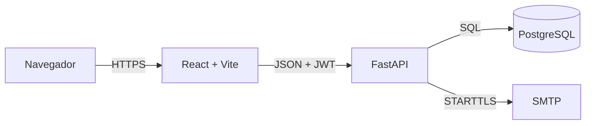
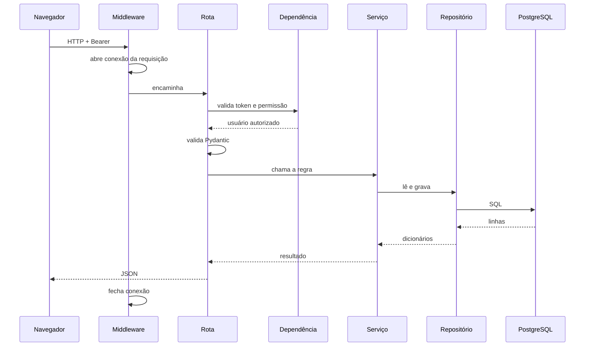

# Arquitetura do Traço Fino

Este documento descreve **como o sistema está organizado**: as camadas, o caminho de uma requisição,
as decisões que mantêm o código previsível e a infraestrutura que coloca tudo no ar. Ele não substitui
a cartilha nem o DER; ele explica como as peças se encaixam.

- O que o sistema precisa fazer: `docs/CARTILHA.md`.
- Como o banco é desenhado: `docs/DER.md`.
- Regras de trabalho e de código: `REGRAS.md`.
- Passo a passo do dia a dia: `docs/COMO_RODAR.md`.

## 1. Visão geral

O projeto é um monorepo com duas aplicações e um banco:



| peça | tecnologia | onde roda |
|---|---|---|
| front | React, Vite, CSS puro | navegador; build estático na Vercel |
| API | FastAPI, SQLAlchemy, psycopg2, Alembic | máquina local ou função serverless da Vercel |
| banco | PostgreSQL | Supabase em produção; local ou Supabase em desenvolvimento |
| email | SMTP com STARTTLS | provedor externo, chamado pela API |

O front nunca fala com o banco. A API é a única que conhece credenciais e regras. O navegador recebe
apenas JSON e o token JWT; imagem só sai da API com o mesmo token.

## 2. Princípios de arquitetura

1. **HTTP não decide regra.** A rota valida contrato e permissão; a regra de negócio mora em
   `backend/servicos/`.
2. **Persistência não conhece HTTP.** O repositório recebe dados primitivos e devolve dicionários;
   ele não levanta `HTTPException` nem monta resposta.
3. **O banco tem uma porta só.** `backend/banco.py` é o único lugar que abre conexão; os
   repositórios recebem um cursor pronto.
4. **A configuração tem um leitor só.** `backend/configuracao.py` é o único arquivo que lê o `.env`,
   e ele lê o `.env` da raiz.
5. **Contrato na borda.** Todo corpo de entrada e toda resposta passam por esquemas Pydantic em
   `backend/esquemas/`; o banco nunca recebe um dicionário sem validação.
6. **Permissão declarada na rota.** As dependências de `backend/rotas/dependencias.py` dizem qual
   permissão a rota exige, e o serviço de autorização concentra o catálogo.
7. **Uma migration por mudança.** Alteração de tabela é arquivo versionado em
   `backend/migracoes/versions/`, nunca `ALTER TABLE` manual.
8. **O front tem um cliente HTTP só.** Nenhuma tela chama `fetch`; tudo passa por
   `frontend/src/api.js`.
9. **Estado de tela explícito.** `App.jsx` guarda a conta, a tela atual e a tatuagem aberta; o
   restante é estado local de cada tela.

## 3. Mapa do repositório

```
.
├── api/index.py            entrada da API no deploy de projeto único da Vercel
├── vercel.json             build do front + rewrite /api para a função
├── backend/
│   ├── api/index.py        entrada da API no projeto separado da Vercel
│   ├── vercel.json         configuração do projeto separado de API
│   ├── main.py             cria o app, CORS, middleware de conexão e routers
│   ├── configuracao.py     único leitor do .env da raiz
│   ├── banco.py            engine, Base, cursor() e Sessao
│   ├── seguranca.py        hash de senha e JWT HS256
│   ├── rotas/              HTTP, dependências e autorização de rota
│   ├── esquemas/           contratos Pydantic de entrada e saída
│   ├── servicos/           regras de negócio
│   ├── repositorios/       SQL explícito e acesso ao banco
│   ├── modelos/            desenho SQLAlchemy das tabelas
│   ├── migracoes/          Alembic e uma migration por mudança
│   ├── tests/              testes unitários dos serviços
│   └── criar_*.py          scripts de montagem do banco e das contas
├── frontend/
│   ├── src/App.jsx         estado da conta, da tela e da tatuagem aberta
│   ├── src/api.js          único cliente HTTP
│   ├── src/perfis.js       papéis, telas e etapas
│   ├── src/telas/          sete telas
│   ├── src/componentes/    onze componentes reutilizáveis
│   ├── src/estilos/        tokens.css e base.css
│   ├── src/fontes/         Playfair Display com licença
│   └── src/imagens/        fotos do ateliê e da vitrine
├── docs/                   cartilha, briefing, DER, arquitetura e styleguide
├── .docs/                  diário de obra: IA, infraestrutura e próximos passos
├── docker-compose.yml      caminho legado com MySQL, API e Caddy
└── Caddyfile               proxy local do caminho com contêineres
```

## 4. O caminho de uma requisição

Uma chamada autenticada, como `POST /tatuagens/{id}/passos`, percorre sempre a mesma ordem:

1. **Middleware de conexão.** `main.py` chama `banco.iniciar_conexao_da_requisicao()`. A conexão
   PostgreSQL fica em um `ContextVar` e é reutilizada por todos os repositórios daquela requisição.
2. **Rota.** O router em `backend/rotas/` recebe o corpo, o caminho e o token.
3. **Autenticação.** `obter_usuario_atual` valida o JWT, carrega a conta, o grupo e as permissões.
4. **Permissão.** A dependência da rota exige um código do catálogo, e às vezes confere se a
   tatuagem pertence ao cliente autenticado.
5. **Contrato.** O corpo é validado por um esquema Pydantic; erro de formato vira 422.
6. **Serviço.** `backend/servicos/` decide se a operação é permitida, aplica a regra e coordena mais
   de uma escrita.
7. **Repositório.** `backend/repositorios/` executa SQL explícito com `cursor()`. Cada bloco confirma
   ou desfaz a própria transação.
8. **Resposta.** O serviço devolve dados simples; a rota converte no esquema de saída e responde
   JSON.
9. **Fim da requisição.** O middleware fecha a conexão e limpa o `ContextVar`.



## 5. Backend em camadas

### 5.1 Rotas

| arquivo | responsabilidade |
|---|---|
| `rotas/autenticacao.py` | login, esqueci a senha, redefinir e alterar senha; valida o token das demais rotas |
| `rotas/usuarios.py` | cadastro público, perfil atual, tatuadores e troca de grupo |
| `rotas/grupos.py` | catálogo de permissões, grupos e atribuição de permissões |
| `rotas/tatuagens.py` | CRUD de tatuagem, filtros e atribuição do tatuador responsável |
| `rotas/passos.py` | histórico e registro de passo |
| `rotas/imagens.py` | upload, listagem, download, aprovação, recusa e remoção |
| `rotas/agendamentos.py` | disponibilidade, criação, listagem e cancelamento |
| `rotas/health.py` | confirmação de disponibilidade sem consultar o banco |
| `rotas/dependencias.py` | fábricas de dependência para permissão e titularidade |

`main.py` não declara rota: ele só cria o app, registra o CORS, instala o middleware de conexão e
inclui os routers.

### 5.2 Esquemas

`backend/esquemas/` separa o contrato de entrada do contrato de saída. O esquema de entrada usa
`Field` para limite e obrigatoriedade; o de saída declara só o que pode ser público. Senha, hash e
token nunca aparecem em esquema de saída.

### 5.3 Serviços

| serviço | decide |
|---|---|
| `servicos/tatuagem.py` | criação, listagem, consulta e atribuição do tatuador |
| `servicos/passo.py` | qual passo é aceito em cada etapa e para onde a etapa vai |
| `servicos/imagem.py` | tipos aceitos, limite de 4 MB, aprovação e recusa |
| `servicos/agendamento.py` | expediente, blocos de uma hora e disponibilidade |
| `servicos/usuario.py` | cadastro, hash de senha, login e perfil público |
| `servicos/grupo.py` | grupos e permissões |
| `servicos/autorizacao.py` | catálogo de permissões e permissões iniciais |
| `servicos/email.py` | envio do link de redefinição por SMTP |
| `servicos/excecoes.py` | erros de negócio que a rota converte em resposta HTTP |

A regra de etapa fica em uma tabela única, `REGRAS_DE_PASSO`, em `servicos/passo.py`. Aprovar um
desenho na etapa `pedida` chama a mesma regra e registra o passo “desenho aprovado”.

### 5.4 Repositórios

Os repositórios usam SQL explícito com `cursor()`, e não o ORM, para deixar a consulta visível e
controlar exatamente o que é lido. Os modelos SQLAlchemy existem para o desenho do banco e para o
Alembic comparar o metadata com o banco.

| repositório | tabelas |
|---|---|
| `repositorios/tatuagem.py` | `tatuagens`, junção com `clientes` e `usuarios` |
| `repositorios/passo.py` | `passos` |
| `repositorios/imagem.py` | `tatuagem_imagens`, com metadado separado do binário |
| `repositorios/agendamento.py` | `agendamentos` e consulta de disponibilidade |
| `repositorios/usuario.py` | `usuarios`, grupos e permissões |
| `repositorios/cliente.py` | nome da cliente para a agenda |
| `repositorios/grupo.py` | `grupos` e `grupos_permissoes` |

### 5.5 Modelos e migrations

As tabelas são declaradas em `backend/modelos/`: `usuario.py`, `cliente.py`, `grupo.py`,
`tatuagem.py`, `passo.py`, `imagem.py` e `agendamento.py`. A `Base` vem de `banco.py`, e é dela que
o Alembic lê o desenho.

A cadeia de migrations é:

```
20261001_01_base_inicial
→ 20261007_01_contas_com_email_e_senha
→ ea09ccd9493f_tabela_de_contas_de_usuario
→ 20261021_01_grupos_e_permissoes
→ 20261106_01_tokens_redefinicao_senha
→ 20261107_01_imagens_e_agendamentos
→ 20261107_02_tatuador_responsavel
```

`python criar_tabelas.py` executa `alembic upgrade head`. Mudança nova segue o caminho
`alembic revision --autogenerate`, leitura do arquivo gerado e `alembic upgrade head`.

### 5.6 Configuração e segurança

`configuracao.py` lê o `.env` da raiz e expõe funções como `endereco_do_banco()` e
`endereco_do_front()`. Ele aceita `SUPABASE_DB_URL` + `SUPABASE_DB_PASSWORD` ou as variáveis
`BANCO_*`, e sempre exige `JWT_SEGREDO`.

`seguranca.py` concentra:

- hash de senha com `pwdlib[argon2]`;
- geração e validação de JWT HS256 com `hmac` e `hashlib`, sem biblioteca externa de JWT;
- expiração pelo campo `exp`.

O token de redefinição de senha é aleatório, só o hash é gravado, e ele expira em 15 minutos. O
login não revela se o e-mail existe na recuperação de senha.

### 5.7 Autorização

A autorização tem duas camadas:

1. **Permissão de rota**, por código do catálogo em `servicos/autorizacao.py`, exigida pelas
   dependências `exigir_permissao` e `exigir_uma_permissao`.
2. **Titularidade**, por `exigir_acesso_a_tatuagem`: quem tem a permissão “própria” só alcança a
   tatuagem cujo `cliente_id` é o da conta; quem tem a permissão “total” alcança todas.

Os grupos iniciais são Cliente, Tatuador e Administrador. O grupo é a fonte de verdade; a coluna
`usuarios.papel` existe para compatibilidade com o front e recebe o código do grupo.

### 5.8 Erros

Erros de negócio usam `servicos/excecoes.py`; a rota traduz para HTTP. Erros de contrato viram 422 do
Pydantic. Erros de permissão viram 403; recurso inexistente ou de outra pessoa vira 404, para não
revelar que ele existe. Erro inesperado sobe e o FastAPI responde 500.

### 5.9 Testes

Os testes ficam em `backend/tests/` e usam `monkeypatch` para substituir repositórios e SMTP. Eles
cobrem redefinição de senha, agenda, imagens e atribuição de tatuador. Não há teste de integração
com PostgreSQL real nem com provedor SMTP; essa é uma lacuna conhecida.

## 6. Modelo de dados

O desenho completo, coluna por coluna, está em `docs/DER.md`. O resumo das relações é:

```
usuarios ──0..1── clientes ──1──< tatuagens ──1──< passos
usuarios ──0..1── tatuagens (tatuador responsável)
usuarios ──1──< agendamentos
tatuagens ──1──< tatuagem_imagens
tatuagens ──1──< agendamentos
grupos ──1──< usuarios
grupos ──1──< grupos_permissoes >──1── permissoes
```

Decisões que importam para quem for mexer:

- **Conta e cliente são coisas diferentes.** `usuarios` guarda quem entra; `clientes` guarda de quem
  é a tatuagem. `usuarios.cliente_id` liga as duas, e fica vazio para tatuador e administrador.
- **Imagem fica no banco.** O binário vai em `tatuagem_imagens.conteudo` (`BYTEA`); a listagem lê só
  metadados e o download é uma rota autenticada.
- **Agenda é do tatuador.** O índice único parcial `uq_agendamentos_tatuador_horario` impede dois
  agendamentos ativos no mesmo horário do mesmo tatuador e libera o horário quando um é cancelado.
- **Etapa e status são texto validado pelo serviço.** Não são `ENUM`, para a lista de valores morar
  em um lugar só.

## 7. Regras de negócio

### 7.1 Etapas da tatuagem

| etapa atual | passo aceito | próxima etapa |
|---|---|---|
| `pedida` | desenho aprovado | `desenho aprovado` |
| `desenho aprovado` | sessão | `em sessões` |
| `em sessões` | sessão | `em sessões` |
| `em sessões` | retoque | `finalizada` |

Sessão antes do desenho aprovado é recusada. Retoque antes de pelo menos uma sessão é recusado. O
passo aceito é o que muda a etapa.

### 7.2 Imagens

- Limite de 4 MB; JPEG, PNG e WebP.
- `tipo` é `desenho` ou `referencia`; `status` é `pendente`, `aprovada` ou `recusada`.
- Só o desenho é aprovado ou recusado.
- Aprovar na etapa `pedida` registra o passo e move a etapa; recusar exige motivo e não move.
- Remover imagem é permitido a quem tem a permissão, e o download exige autenticação.

### 7.3 Agenda

- Bloco de uma hora, no fuso fixo UTC-3.
- Segunda a sexta: 08:30–17:30, com almoço; sábado: 08:00–11:00; domingo fechado.
- Sessão e retoque usam a agenda do tatuador responsável.
- Horário ocupado não aparece como disponível; cancelar libera o bloco sem apagar o registro.

## 8. Frontend

### 8.1 Estado e navegação

Não há biblioteca de rotas. `App.jsx` guarda:

- a conta autenticada e as permissões;
- a tela atual;
- a tatuagem aberta.

`perfis.js` define os papéis e a ordem das telas de cada um. A tela de login alterna entre entrar,
cadastrar, esqueci a senha e redefinir senha.

### 8.2 Autenticação

O login chama `POST /autenticacao/login` e guarda o token em `sessionStorage`, na chave
`traco-fino-token`. Ao recarregar, o front chama `GET /usuarios/eu` para restaurar o perfil. O prazo
do JWT é lido no próprio token; quando vence, a sessão é limpa e o login volta. Nenhuma tela lê o
token diretamente: quem anexa o cabeçalho `Authorization` é `api.js`.

### 8.3 Telas

| tela | papel | aparelho | arquivo |
|---|---|---|---|
| Login, cadastro e recuperação | todos | ambos | `telas/Login.jsx` |
| Pedir tatuagem | Cliente | celular | `telas/PedirTatuagem.jsx` |
| Minhas tatuagens | Cliente | celular | `telas/MinhasTatuagens.jsx` |
| A agenda | Tatuador | computador | `telas/Agenda.jsx` |
| A ficha | Tatuador | computador | `telas/Ficha.jsx` |
| Administração | Administrador | computador | `telas/Administracao.jsx` |
| Alterar senha | todos | ambos | `telas/AlterarSenha.jsx` |

Cada tela que chama a API tem três estados: carregando, pronto e erro. Lista vazia é um quarto
estado visual, tratado pelo componente de avisos.

### 8.4 Componentes

| componente | papel |
|---|---|
| `Logo.jsx` | logo claro ou escuro, servido de `docs/marca/` |
| `AlternadorTema.jsx` | alterna o tema e guarda a escolha |
| `CampoSenha.jsx` | senha com mostrar/ocultar |
| `CabecalhoDaTela.jsx` | título, apoio e ação principal |
| `Avisos.jsx` | carregando, erro e vazio |
| `Etiqueta.jsx` | etiqueta da etapa |
| `ProgressoDasEtapas.jsx` | régua das quatro etapas |
| `LinhaDoTempo.jsx` | histórico de passos |
| `ImagensDaTatuagem.jsx` | upload, listagem, aprovação, recusa e remoção |
| `MiniaturaDoDesenho.jsx` | miniatura do desenho na agenda |
| `AgendaDaTatuagem.jsx` | sessões, retoque, disponibilidade e cancelamento |

### 8.5 Estilos e tema

`estilos/tokens.css` guarda as variáveis do styleguide: cores, espaçamento, tipografia e os dois
temas. `estilos/base.css` tem o que toda tela compartilha e as variações de componente. Nenhuma tela
escreve código de cor: cor é sempre variável. O CSS é mobile-first, e o ajuste de computador fica em
`@media`.

### 8.6 Imagens e agenda na tela

A imagem é baixada por `fetch` autenticado e vira `object URL`; um `` comum não
enviaria o token. O front repete o limite de 4 MB e os tipos só para avisar antes do envio; a
validação real é do back. A disponibilidade da agenda vem pronta do back, porque expediente e
bloqueio são regra de servidor.

## 9. Infraestrutura e deploy

### 9.1 Ambiente local

1. `.env` na raiz com banco, JWT, CORS e SMTP.
2. `cd backend` e `python criar_tabelas.py`.
3. `cd backend`, ativar o venv e `fastapi dev main.py`.
4. `cd frontend` e `npm run dev`.

### 9.2 Produção

O caminho atual é **Vercel + Supabase**:

- React estático na Vercel;
- API como função serverless, em `api/index.py` ou `backend/api/index.py`;
- PostgreSQL no Supabase, com SSL obrigatório;
- SMTP externo para o link de redefinição.

Há dois desenhos de deploy: um projeto único na Vercel, com o `vercel.json` da raiz, ou dois projetos
separados, com Root Directory `frontend/` e `backend/`. No segundo, o `frontend/vercel.json` faz o
proxy `/api/*`.

### 9.3 Variáveis de ambiente

| variável | uso |
|---|---|
| `SUPABASE_DB_URL` | URL do PostgreSQL do Supabase |
| `SUPABASE_DB_PASSWORD` | senha separada da URL |
| `BANCO_SSLMODE` | `require` em produção |
| `BANCO_HOST`, `BANCO_PORTA`, `BANCO_NOME`, `BANCO_USUARIO`, `BANCO_SENHA` | alternativa para PostgreSQL local |
| `JWT_SEGREDO` | segredo do JWT, com pelo menos 32 caracteres |
| `JWT_MINUTOS` | validade do token |
| `ORIGEM_FRONTEND` | origem exata liberada no CORS e usada no link de senha |
| `SMTP_HOST`, `SMTP_PORT`, `SMTP_USER`, `SMTP_PASSWORD`, `SMTP_FROM_EMAIL` | envio de email |
| `VITE_URL_DA_API` | endereço da API usado pelo front |

### 9.4 O que é legado

O `docker-compose.yml` da raiz ainda descreve MySQL 8.4, `api` e `web`, e o `Caddyfile` descreve o
proxy local desse caminho. A API atual usa PostgreSQL. O Compose não deve ser tratado como
documentação da produção nem como prova de conexão funcional com o banco atual.

## 10. Convenções do projeto

- Código, nomes, comentários, documentação e respostas em português do Brasil.
- Tabela no plural, classe no singular: `tatuagens` / `Tatuagem`.
- Rota no plural e sem verbo no caminho; o verbo é o método HTTP.
- Regra de negócio em serviço, SQL em repositório, contrato em esquema, HTTP em rota.
- Comentário curto explica intenção e motivo, não repete a linha.
- Nenhuma cor escrita fora de `tokens.css`.
- Nenhuma chamada `fetch` fora de `api.js`.
- Nenhum segredo no Git, no README ou nos documentos.

## 11. Checklist para uma funcionalidade nova

1. **Banco:** criar ou alterar o modelo em `backend/modelos/` e gerar a migration com
   `alembic revision --autogenerate`.
2. **Migration:** ler o arquivo gerado antes de aplicar; conferir chave, índice e `NOT NULL`.
3. **Repositório:** escrever o SQL em `backend/repositorios/` e devolver dicionários simples.
4. **Serviço:** colocar a regra em `backend/servicos/`, com erro de negócio próprio.
5. **Esquema:** definir entrada e saída em `backend/esquemas/`, sem expor hash ou token.
6. **Permissão:** acrescentar o código em `servicos/autorizacao.py` e exigi-lo na rota.
7. **Rota:** montar a rota em `backend/rotas/`, com a dependência de permissão.
8. **Front:** acrescentar a função em `api.js` e a tela ou componente em `src/`.
9. **Teste:** cobrir a regra em `backend/tests/`, com `monkeypatch` quando não houver banco.
10. **Documentação:** atualizar `README.md`, `docs/DER.md`, `docs/ARQUITETURA.md` e
    `docs/COMO_RODAR.md` quando a mudança afetar o que está escrito.

## 12. Lacunas conhecidas

- `backend/modelos/tatuagem.py` não declara `tatuador_id`, embora a migration e o repositório usem a
  coluna. O modelo está incompleto em relação ao banco.
- `docker-compose.yml` e `Caddyfile` descrevem MySQL e um caminho antigo; são legado.
- Não há teste de integração com PostgreSQL real nem com SMTP.
- A funcionalidade de IA descrita em `.docs/ia.md` está planejada, sem rota, tela ou implementação.
- `.docs/ia.doc` não foi confirmado como documento texto ou binário.
